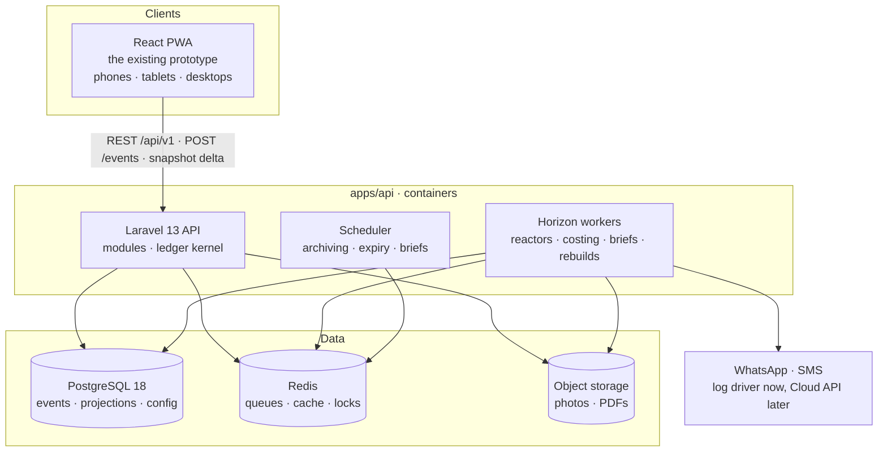
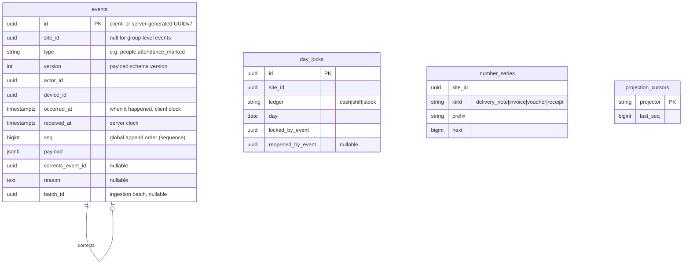
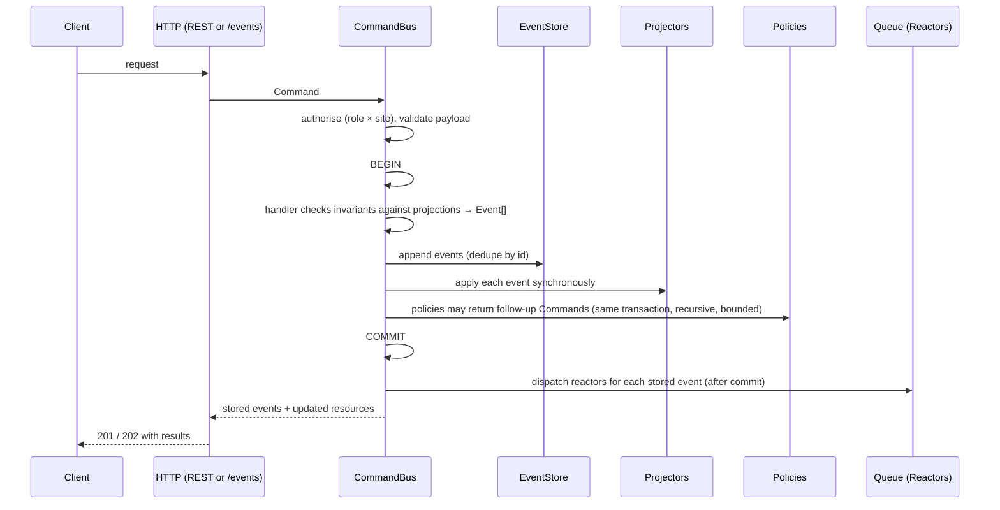

# Tanaad Management System — Backend Architecture

**Status:** Proposed for build, 9 November 2026
**Stack:** Laravel 13 · PHP 8.5 · PostgreSQL 18 · Redis 7 · Horizon · Sanctum · Pest
**Reads with:** `docs/adr/ADR-002` … `ADR-011`, `docs/plans/BACKEND_DELIVERY_PLAN.md`
**Inputs:** Project Definition Document (§10–§14, §18, Appendix B), ADR-001, `packages/domain/src/types.ts`, the 55 write actions in `apps/web/src/data/store.ts`

---

## 1. What this document covers

The server that the existing React prototype will talk to. The prototype stays the frontend; it already has the domain types, the arithmetic and a local event-and-projection store, so the backend is designed to be the authoritative version of exactly that model.

In scope: the API, the event ledger, projections, authorisation, sync, master data, scheduled jobs, media, and the integration seams for messaging and documents.

Out of scope for this build (decided, not forgotten — see §23): the Capacitor Android shell, real scale and printer drivers, URA EFRIS, mobile-money disbursement, websockets, PowerSync, per-factory edge servers.

## 2. Goals and constraints

From the PDD, the numbers the design must meet:

| Constraint | Value |
|---|---|
| Sites, people, machines | 3 sites, ~200 workers, ~50 machines, 10 roles |
| Write volume | ~5,000 events/day, 10-year retention, ×10 headroom |
| Offline | Floor screens work 72 h without network; outbox ≥ 10,000 events per device |
| Availability | Floor functions 100% local; server 99.5% monthly |
| Records | Append-only; every correction, reopen and override is itself a record with a reason |
| Multi-currency | UGX and USD with a daily reference rate |
| Data law | Uganda Data Protection and Privacy Act 2019; ID and face photos are sensitive data |

And the engineering constraint from the brief: a Laravel-strong team, AI-assisted, targeting about two months to a usable backend across all modules.

## 3. The system in one picture



## 4. Principles

1. **One ledger.** Every business write is an immutable event in one `events` table. Online and offline writes land in the same table through the same command handlers. Nothing is updated in place except projections, which are derived and rebuildable.
2. **Commands decide, events record.** A command is validated and authorised against current state; if it passes, it produces one or more events. Clients that worked offline send their events as *proposed* commands, and the server may reject them.
3. **Projections are disposable.** Every read model can be truncated and rebuilt from the events. A rebuild must produce identical projection rows, so projectors are deterministic and free of side effects.
4. **Side effects run once.** Anything that touches the outside world (WhatsApp, PDFs, emails) is a reactor on a queue, keyed by event id, and never runs during a rebuild.
5. **Everything the business defines is data.** Products, sizes, categories, stages, shifts, downtime reasons, deduction presets, benchmarks and tolerances are rows in config tables, editable by Group Admin, never constants in code.
6. **Modules talk through events.** A module owns its tables and its commands. Another module may react to its events, never query its tables or call its handlers.
7. **The contract is generated, then committed.** OpenAPI comes from the Laravel code and is committed; the TypeScript client and types are generated from it. Arithmetic is verified on both sides from the same JSON fixtures.

## 5. Modules

A modular monolith. One Laravel application, PSR-4 namespace `Tanaad\`, one directory per module under `modules/`, each with its own service provider, migrations, routes and tests. No module package dependency; the boundaries are enforced by architecture tests (§19).

| Module | Owns | Listens to |
|---|---|---|
| `Shared` | Ledger kernel (event store, projector and reactor dispatch, day locks, number series), site scoping, business calendar, money and quantity types, problem+json errors | — |
| `Identity` | Users, roles per site, devices, device sessions and PINs, tokens | — |
| `Config` | Sites, site settings, ref lists, products, prices, machines, benchmarks, zones, company profile, FX rates | — |
| `People` | People, engagements, attendance, settlement runs, payouts, advances, auto-archiving | — |
| `Cash` | Cash days, entries, close and reopen, variance | People (`payout_recorded`), Production (`collector_paid`), Orders (`order_cash_confirmed`, cash `payment_recorded`) |
| `Production` | Production entries, downtime, batches, labels and their history, waste weighings, collector intake, shift close, mass balance | Stock (`label_scrapped`) |
| `Stock` | Stock on hand, movements, counts, adjustments, transfers, purchases, parts, part issues, breakdowns | Production (`label_created`, `label_consumed`), Dispatch (`gate_pass_issued`) |
| `Dispatch` | Pick lists, bundle scans, gate weights and decisions, delivery notes, proof of delivery | Orders (`order_approved`, `order_cash_confirmed`) |
| `Orders` | Clients, orders, approval and cash confirmation, invoices, payments, balances, credit | Dispatch (`delivery_confirmed`) |
| `Costing` | Cost lines, unit cost per product per period, site P&L | Cash, People, Production, Stock events |
| `Group` | Exceptions (raised and decided), audit feed, morning brief, cockpit queries | Every module's events (policies) |
| `Media` | Hash-addressed uploads, signed URLs | — |
| `Messaging` | Outbound message log, WhatsApp/SMS drivers | Group (`brief_due`, critical `exception_raised`), Orders (`document_shared`) |
| `Documents` | PDF rendering of invoices, delivery notes, statements, vouchers | Orders, Dispatch |

**Dependency rule.** `Shared` depends on nothing. Every other module may depend on `Shared` and on another module's `Events` namespace only. `Group`, `Costing`, `Messaging` and `Documents` are downstream: nothing depends on them.

## 6. The ledger kernel (`Tanaad\Shared\Ledger`)

### 6.1 Tables



`events` is append-only at the database level: the application role has `INSERT` and `SELECT` only. Partitioning by month is added when the table passes ~20 M rows; the schema does not change.

### 6.2 Classes

```
Shared/Ledger/
  Event.php                 immutable value object: id, type, siteId, actorId, deviceId, occurredAt, payload, correctsEventId, reason
  EventEnvelope.php         what a client sends (Event minus server fields) + provisional refs
  EventStore.php            append(Event[]): persists, assigns seq, returns stored events; dedupes by id
  Command.php               marker interface; every command carries siteId, actorId, deviceId, occurredAt
  CommandBus.php            authorise → validate → handle → store events → run projectors → run policies → commit → queue reactors
  Handler.php               interface: handle(Command): Event[]
  Projector.php             interface: handles(): string[]; apply(StoredEvent): void; reset(): void
  Policy.php                interface: handles(): string[]; react(StoredEvent): Command[]   (synchronous, deterministic)
  Reactor.php               interface: handles(): string[]; react(StoredEvent): void        (queued, idempotent, side effects)
  Rejection.php             exception with code + human reason, mapped to problem+json and to ingestion results
  DayLocks.php              assertOpen(site, ledger, day); lock(...); reopen(...)
  NumberSeries.php          allocate(site, kind): string   (SELECT … FOR UPDATE inside the command transaction)
  Replay.php                rebuild(projectors[], from seq): truncates and replays in seq order
```

### 6.3 Write flow



Everything inside the transaction is deterministic. Reactors run after commit, are keyed by `event.id`, and check a `reactor_runs (reactor, event_id)` table so a retry never repeats a WhatsApp message.

### 6.4 Rebuild

`php artisan ledger:rebuild {projector?} {--from-seq=}` truncates the projector's tables, replays events in `seq` order and updates `projection_cursors`. Policies and reactors are disabled during a rebuild. A test asserts that rebuilding every projector reproduces the current projection rows exactly.

### 6.5 Corrections and reopenings

- A correction is a new event with `corrects_event_id` and a `reason`; the original stays. Projectors apply corrections as reversals plus re-applications.
- A day close (`cash.day_closed`, `production.shift_closed`, `stock.counted`) writes a `day_locks` row. Handlers call `DayLocks::assertOpen()`; a write into a locked day is rejected with `day_locked` unless the command is a reopen by an authorised role, which writes `reopened_by_event`.

## 7. Write path: commands

### 7.1 REST endpoints

Each write endpoint maps a validated request to a Command and runs it through the bus. The endpoint returns the created or changed resource plus the ids of the stored events. There is no second write path; controllers never touch projection tables.

### 7.2 Offline ingestion: `POST /api/v1/events`

Clients that worked offline send their outbox. Each envelope is turned into the same Command the REST endpoint would have built, so validation, authorisation and invariants are identical.

Request:

```json
{
  "batch_id": "0192f0a1-…",
  "events": [
    {
      "id": "0192f0a1-7c3e-7b2a-…",
      "type": "people.attendance_marked",
      "version": 1,
      "site_id": "…",
      "device_id": "…",
      "occurred_at": "2026-11-09T07:42:10+03:00",
      "payload": { "person_id": "…", "shift_id": "…", "status": "present" }
    }
  ]
}
```

Response `200`:

```json
{
  "results": [
    { "id": "0192f0a1-…", "status": "accepted", "seq": 48213, "assigned": { "delivery_note_no": "DN-00031" } },
    { "id": "0192f0a2-…", "status": "duplicate" },
    { "id": "0192f0a3-…", "status": "rejected", "code": "day_locked", "reason": "Cash day 2026-11-08 was closed at 18:40 by Joseph Okello." }
  ],
  "snapshot_seq": 48213
}
```

Rules:
- The actor is taken from the authenticated session, never from the envelope.
- Events are processed in the order sent, each in its own transaction, so one rejection does not fail the batch. A rejected event is never stored; the client marks it, shows the reason and keeps the record locally for the user to redo or discard.
- `duplicate` means the id is already stored; the response is identical to the original acceptance.
- Numbers from a series (delivery notes, invoices, vouchers) are assigned at ingestion and returned under `assigned`; the client replaces its provisional reference.
- Rejection codes are a closed list: `unknown_type`, `invalid_payload`, `forbidden`, `day_locked`, `not_found`, `state_conflict`, `duplicate_fact`, `stale_config`.

### 7.3 Conflict rules

Two events about the same fact both survive in the ledger; business rules decide the projection:

| Case | Rule |
|---|---|
| Two `present` marks for one person, one shift | Second is `duplicate_fact`, not stored |
| `present` at two sites in one shift | Both stored; `Group` policy raises an exception for review |
| Entry into a closed day | Rejected `day_locked`; a reopen event by Site Manager with reason unlocks it |
| Scan of a label already dispatched | Rejected `state_conflict` with the dispatch that holds it |
| Config changed between offline write and sync (price, benchmark) | Accepted; payload carries the values the client used; projector records the snapshot values, not current config |

## 8. Read path: projections and snapshots

### 8.1 Read models

Every projection table carries `site_id` (nullable for group rows), `seq` (the event seq that last touched the row, indexed) and `deleted_at` (tombstone so deletes reach offline clients). Read models per module are listed in Appendix B.

### 8.2 Snapshot delta: `GET /api/v1/sites/{site}/snapshots/{projection}?since={seq}`

Returns rows with `seq > since` for one projection, plus `snapshot_seq`. The client stores the high-water mark per projection and asks for changes since it. A full load is `since=0`. Pagination by `seq` cursor, 1,000 rows a page. This replaces websockets for now: the client polls after its own flush and on a timer when the screen is a monitor (machine wall, cockpit).

### 8.3 Query endpoints

Dashboards and reports that aggregate across projections (cockpit, P&L, mass balance for a day, client balance) are read-only query endpoints in the owning module, backed by SQL views or query classes. They are never used by offline screens, which compute from local snapshots using the shared arithmetic.

## 9. Rules: policies and reactors

**Policies** are synchronous, deterministic and run inside the writing transaction. They turn one event into follow-up commands. **Reactors** are asynchronous side effects.

| Trigger event | Policy (sync) | Reactor (async) |
|---|---|---|
| `dispatch.gate_weight_recorded` beyond tolerance | `Group`: raise `gate_variance`, critical | `Messaging`: alert CEOs |
| `cash.day_closed` with counted ≠ expected beyond tolerance | raise `cash_variance` | — |
| `production.entry_recorded` below benchmark without reason | raise `below_benchmark` | — |
| `production.shift_closed` with a machine unlogged | raise `not_logged` | — |
| `orders.order_created` taking a client over its limit | mark order `awaiting_approval`, raise `credit_over_limit` | notify approval owner |
| `people.engagement_started` (contract) / daily scheduler | raise `contract_expiring` at N days | — |
| `stock.part_issued` taking a part below minimum | raise `low_stock` | — |
| `dispatch.delivery_confirmed` with a count mismatch | raise `pod_discrepancy` | — |
| `orders.document_shared` | — | `Documents` render PDF → `Messaging` send |
| `group.brief_due` (scheduler) | — | build brief, send, record `brief_sent` |

Exception kinds and their thresholds (tolerance %, benchmark %, warning days, low-stock minimum, credit warning level) are site config, not code.

## 10. Identity and authorisation

- **Roles** are the ten in `packages/domain`: `ceo`, `group_admin`, `site_manager`, `supervisor`, `cashier`, `storekeeper`, `gate`, `mechanic`, `sales`, `driver`. A user holds roles per site (`user_site_roles`); `ceo` and `group_admin` are group-scoped (site null) and read every site.
- **Office and CEO sign-in:** email + password → Sanctum token. OTP and passkeys are a later addition behind the same endpoint.
- **Shared floor tablets:** Group Admin registers a device (`devices` row, device token with ability `device`). A user unlocks it with `POST /auth/pin` → a short-lived user token bound to that device (ability `device:{id}`, expiry per role). Wrong-PIN lockout after five attempts.
- **Authorisation** is a `Policy` per command class: `allows(User, Command)` checking role × site and separation of duties (loader ≠ variance approver, cashier ≠ day reopener, mechanic ≠ spares receiver). The bus runs it before validation. Read endpoints use the same role matrix via route middleware.
- **Site scoping** is enforced in the application layer: every projection query is scoped by the sites the token may see. PostgreSQL row-level security is deferred (ADR-006); the schema is ready for it because every row has `site_id`.

## 11. Time, business day, shifts, numbering

- All timestamps are stored `timestamptz`; the business timezone is `Africa/Kampala`. `occurred_at` comes from the client (it may be hours old after an outage); `received_at` is the server clock.
- The **business day** of an event is derived from `occurred_at` and the site's shift table: a night shift that starts 19:00 belongs to the calendar day it started. `Shared\Calendar::businessDay(site, occurredAt)` and `shiftId(site, day, kind)` mirror the TypeScript selectors.
- **Number series** (delivery notes, invoices, vouchers, receipts) are allocated server-side inside the command transaction from `number_series` with a row lock. Prefix and starting number per site are config, so the bags factory can continue its current book.

## 12. Money and quantities

- Amounts: `numeric(16,2)` plus a `currency` column (`UGX` | `USD`); never floats in the database. In PHP, `brick/math` `BigDecimal`; in JSON, numbers (to match the TypeScript types), rounded with the same rules as `round2`/`round3`.
- Weights: `numeric(12,3)` kg. Percentages: `numeric(7,3)`.
- FX: a daily reference rate per currency pair in `fx_rates`; every event that involves USD carries the rate used in its payload so projections and costing are reproducible.
- The arithmetic in `packages/domain/src/arithmetic.ts` is ported one-to-one to `Shared\Arithmetic` and both are tested against `contracts/fixtures/*.json`.

## 13. Configuration and master data

`Config` owns everything the business defines: sites and their shift tables, stages, sectors, downtime reasons, breakdown causes, expense sub-categories, deduction presets, pellet grades, bag sizes, vehicles, payment methods and whether they need a reference, zones, products (internal and commercial names, bundle pieces, standard weight and its measured status), prices per currency, machines, benchmarks per machine and product, thresholds, label layouts, number series, company profile. All of it is editable through the API by `group_admin` and, for site-level lists, `site_manager`. Every change is a `config.*` event, so the audit feed shows who changed a benchmark and when.

`GET /sites/{site}/config` returns the complete site configuration in the shape `apps/web/src/config/sites/*.ts` already expects, so the prototype's site config files become the seed, then the API becomes the source.

## 14. Scheduled jobs

| Job | When | Does |
|---|---|---|
| `people:archive-absent` | daily 23:30 | casuals absent N consecutive working days → `person_archived` |
| `people:contract-expiry` | daily 06:00 | `contract_expiring` exceptions at the configured warning days |
| `production:shift-unlogged` | end of each shift + 30 min | `not_logged` exceptions for machines without an entry |
| `group:morning-brief` | per CEO configured time | builds and sends the brief |
| `costing:close-period` | nightly | recomputes unit costs from closed days only |
| `ledger:verify` | nightly | rebuilds one projector into a shadow schema and diffs it; alerts on drift |
| `media:purge-orphans` | weekly | removes uploads no event references after 7 days |

## 15. Media, documents, messaging

- **Media:** `POST /media` accepts a file and returns its SHA-256; the event payload references the hash. Storage is S3-compatible (MinIO locally); reads are signed, expiring URLs. Face and ID images live in a separate bucket with HR-only access.
- **Documents:** `Documents` renders PDFs from the same React print routes through headless Chromium (Browsershot). Until that ships, `POST /documents/{kind}/{id}/render` returns the document's data and the frontend keeps using the browser print dialog.
- **Messaging:** a `Messenger` interface with `log` (default), `whatsapp_cloud` and `sms` drivers. Every send is a row in `outbound_messages` with status and provider response. The log driver makes briefs and alerts visible in the audit feed now, with no external cost.

## 16. API conventions

- Base path `/api/v1`. JSON only. Errors are RFC 9457 `application/problem+json` with the same closed code list as ingestion.
- Resources use `snake_case` keys, UUID ids, ISO 8601 timestamps with offset, and `seq` on every projection row.
- Lists paginate by cursor (`seq` or `id`), never by page number.
- Writes are idempotent where a client might retry: every write request accepts an `Idempotency-Key` header, which becomes the event id.
- OpenAPI 3.1 is generated by `dedoc/scramble` on every CI run, exported to `contracts/openapi.yaml`, diffed with `oasdiff` (breaking change fails the build), and `openapi-typescript` regenerates `packages/domain/src/api.gen.ts`.

## 17. Data conventions

- Table names plural `snake_case`; event types `module.past_tense` (`cash.day_closed`).
- UUIDv7 everywhere (`Symfony\Component\Uid\UuidV7`), generated by the client for events created offline and by the server otherwise.
- Projections have no updated-in-place history; the ledger is the history. They carry `seq` and `deleted_at` for delta sync and nothing else temporal except the business fields.
- Indexes: `events (site_id, seq)`, `events (type, seq)`, `events (actor_id, occurred_at)`; every projection `(site_id, seq)` plus its natural lookups.
- Migrations live in the module that owns the table. The `Shared` migrations run first.

## 18. Directory structure

### 18.1 Repository (after the Phase 0 move, ADR-010)

```
tanaad/
  apps/
    web/            the React prototype
    api/            Laravel 13
  packages/
    domain/         TS types (hand-written now, generated from OpenAPI later), arithmetic, fixtures loader
  contracts/
    openapi.yaml    generated and committed
    events/         JSON Schema per event type and version
    fixtures/       arithmetic fixtures shared by Pest and Vitest
  infra/
    docker-compose.yml, php/Dockerfile, nginx/, postgres/init.sql
  tools/            screenshots, PWA check
  docs/
    adr/ architecture/ plans/   (tracked; client material stays untracked)
  .github/workflows/
```

### 18.2 `apps/api`

```
apps/api/
  app/                      Laravel defaults kept minimal: Providers/AppServiceProvider, Console/Kernel
  bootstrap/providers.php   registers each module's provider
  config/tanaad.php         feature flags, timezone, tolerances fallback, drivers
  modules/
    Shared/
      Ledger/  Calendar/  Money/  Http/ (ProblemResponse, ApiController)  Database/migrations/
      Arithmetic/  Testing/ (FixtureCase, LedgerTestCase)  SharedServiceProvider.php
    Identity/  Config/  People/  Cash/  Production/  Stock/  Dispatch/  Orders/  Costing/  Group/  Media/  Messaging/  Documents/
  routes/api.php            only `require`s each module's routes
  tests/                    Pest bootstrap, architecture tests, replay test, OpenAPI contract test
```

### 18.3 Module template

```
modules/Cash/
  CashServiceProvider.php     binds handlers, registers projectors/policies/reactors, loads migrations and routes
  Commands/                   RecordCashEntry.php, CloseCashDay.php, ReopenCashDay.php, CorrectCashEntry.php
  Handlers/                   one per command
  Events/                     CashEntryRecorded.php … (typed payload classes + JSON schema id)
  Projectors/                 CashDayProjector.php, CashEntryProjector.php
  Policies/                   CashVariancePolicy.php
  Authorization/              CashCommandPolicy.php (role × site × separation of duties)
  Models/                     CashDay.php, CashEntry.php (Eloquent, read-only outside projectors)
  Http/
    Controllers/  Requests/  Resources/  routes.php
  Queries/                    CashSummaryQuery.php (dashboard aggregates)
  Database/migrations/  Database/factories/  Database/Seeders/
  Tests/                      Feature (HTTP → events → projection), Unit (handler invariants), Replay
```

Coding standards: PHP 8.5 with `declare(strict_types=1)` in every file, Laravel Pint, Larastan level 8, `final` and `readonly` classes by default (commands and events are `final readonly`), no facades inside `modules/*/Handlers` (constructor injection so handlers are unit-testable).

## 19. Testing strategy

| Layer | Tool | What it proves |
|---|---|---|
| Arithmetic fixtures | Pest + Vitest over `contracts/fixtures` | client and server agree on gate decision, mass balance, settlement, cash close, intake, landed cost |
| Handler unit | Pest | invariants and rejections for each command, no database |
| Feature | Pest HTTP | request → events stored → projection rows → response shape |
| Ingestion | Pest | batch with accepted, duplicate and rejected items; order; assigned numbers |
| Replay | Pest | rebuild every projector from events and diff against live rows |
| Architecture | pest-plugin-arch | module dependency rule, no Eloquent writes outside projectors, no facades in handlers |
| Contract | Pest + Scramble | generated OpenAPI validates; every route documented; `oasdiff` in CI |
| Policy matrix | Pest dataset | role × command allow/deny table |

Coverage target: handlers and projectors 100% of branches; the rest pragmatic.

## 20. Environments, deployment, operations

- **Local:** `infra/docker-compose.yml` with `php:8.5-fpm`, `nginx`, `postgres:18`, `redis:7`, `horizon`, `scheduler`, `minio`, `mailpit`. `make up`, `make test`, `make rebuild`. The host machine's PHP version is irrelevant; everything runs in the containers.
- **CI (GitHub Actions):** Pint, Larastan, Pest with Postgres service, OpenAPI export and diff, TypeScript client regeneration check, web typecheck and Vitest.
- **Staging:** one VM in the region chosen under ADR-001 (in-country if available, else `af-south-1`), Docker Compose, TLS by Caddy or nginx + certbot, nightly `pg_dump` to object storage, weekly restore to a scratch database as a drill.
- **Observability:** JSON logs to stdout; Sentry (or self-hosted GlitchTip) for exceptions; `/up` health; Horizon dashboard behind admin auth; a `device_heartbeats` table fed by the client with its pending outbox count, surfaced as the sync-lag metric.

## 21. Security baseline

TLS only; Sanctum tokens hashed at rest; PINs hashed with Argon2id; device tokens revocable from Group settings; rate limits on `/auth/*` and `/events`; secrets via environment, never in the repository; personal data never in logs; face/ID images in an HR-only bucket; pinned Composer and pnpm dependencies with Dependabot; signed container images later. The DPIA and PDPO registration are client tasks tracked in the plan.

## 22. Frontend integration path

The prototype already keeps all data in a Zustand store fed by a seed and writes through actions. The adapter (ADR-011) adds, behind `VITE_API_URL`:

1. `auth`: login and PIN endpoints replace the Switcher; the session holds the token and the allowed sites and roles.
2. `bootstrap`: `GET /me`, `GET /sites/{site}/config`, then `snapshots/*?since=0` fill the store instead of `buildSeed()`.
3. `outbox`: every store action also appends an `EventEnvelope` to a Dexie table; `flushOutbox` posts batches to `/events`, applies `assigned` values, marks `accepted`/`duplicate`, and surfaces `rejected` with the reason.
4. `delta`: after a flush and on a timer, pull `snapshots/*?since=` and merge into the store.
5. Demo mode (`VITE_DEMO=1`) keeps the seed and simulators; the presenter panel stays excluded from production builds.

Nothing in the screens changes; they keep reading selectors and calling actions.

## 23. Deferred decisions

| Topic | Decision now | Revisit when |
|---|---|---|
| Live updates | Polling via snapshot delta | Machine walls need < 5 s latency → Reverb |
| Read sync engine | Custom delta | Delta maintenance cost shows → PowerSync spike |
| Row-level security | Application scoping | External reporting tools connect to the database |
| Event partitioning | Single table | > 20 M rows |
| Aggregate-root event sourcing | Not used (ADR-003) | Only if invariants outgrow projection checks |
| EFRIS | Not connected; invoice carries fiscal fields | Client confirms URA registration path |
| Mobile money disbursement | Reference capture only | Merchant onboarding done |
| Capacitor, BLE scales, printers | Browser only | Hardware purchased |
| Edge server per factory | None | Uplink worse than the outbox absorbs |

---

## Appendix A — Command and event catalogue

Mapped from the prototype's store actions so the frontend adapter is mechanical. Event types are `module.past_tense`.

### Identity (not ledgered except for audit)
| Store action | Endpoint | Event (audit) |
|---|---|---|
| `logIn` / `signIn` / `signOut` | `POST /auth/login`, `/auth/pin`, `DELETE /auth/session` | `identity.session_opened` (device sessions only) |
| — (admin) | `POST /devices`, `POST /users/{id}/roles` | `identity.device_registered`, `identity.role_assigned` |

### Config
| Store action | Command | Event |
|---|---|---|
| `addRef` / `updateRef` / `moveRef` | `ChangeRefList` | `config.ref_list_changed` |
| `updateSiteSettings` | `UpdateSiteSettings` | `config.site_settings_changed` |
| `saveProduct` | `SaveProduct` | `config.product_saved` |
| `saveMachine` | `SaveMachine` | `config.machine_saved` |
| `setBenchmark` | `SetBenchmark` | `config.benchmark_set` |
| `saveZone` | `SaveZone` | `config.zone_saved` |
| `setFx` | `SetFxRate` | `config.fx_rate_set` |
| `updateCompanyProfile` | `UpdateCompanyProfile` | `config.company_profile_changed` |
| — | `SetPrice` | `config.price_set` |

### People
| Store action | Command | Event(s) |
|---|---|---|
| `registerCasual` | `RegisterPerson` | `people.person_registered`, `people.engagement_started` |
| — | `StartEngagement` / `EndEngagement` | `people.engagement_started` / `people.engagement_ended` |
| `renewContract` | `RenewEngagement` | `people.engagement_renewed` |
| `markAttendance` | `MarkAttendance` | `people.attendance_marked` or `people.attendance_corrected` |
| `archivePerson` / `reactivatePerson` | `ArchivePerson` / `ReactivatePerson` | `people.person_archived` / `people.person_reactivated` |
| settlement (session-local today) | `CreateSettlementRun`, `ApproveSettlement`, `RecordPayout`, `GiveAdvance` | `people.settlement_run_created`, `people.settlement_approved`, `people.payout_recorded`, `people.advance_given` |

### Cash
| Store action | Command | Event(s) |
|---|---|---|
| `addCashEntry` | `RecordCashEntry` | `cash.day_opened` (first entry of a day), `cash.entry_recorded` |
| — | `CorrectCashEntry` | `cash.entry_corrected` |
| `closeCashDay` | `CloseCashDay` | `cash.day_closed` (+ policy: `group.exception_raised` cash_variance) |
| `reopenCashDay` | `ReopenCashDay` | `cash.day_reopened` |

### Production
| Store action | Command | Event(s) |
|---|---|---|
| `recordProduction` | `RecordProductionEntry` | `production.entry_recorded`, `production.downtime_recorded` |
| — (mixer) | `RecordBatch` | `production.batch_mixed` |
| `createLabel` | `CreateLabel` | `production.label_created` |
| `consumeLabel` | `ConsumeLabel` | `production.label_consumed` |
| — (waste) | `WeighWaste` | `production.waste_weighed` |
| `recordIntake` | `RecordCollectorIntake` | `production.collector_delivery_recorded` |
| `payCollector` | `PayCollector` | `production.collector_paid` (Cash projector adds the line) |
| — | `CloseShift` | `production.shift_closed` (+ `not_logged` policy) |

### Stock
| Store action | Command | Event(s) |
|---|---|---|
| — | `ReceiveStock` | `stock.received` |
| `moveStock` | `MoveStock` | `stock.moved` |
| `recordStockCount` | `RecordStockCount` | `stock.counted`, `stock.adjusted` |
| — | `ScrapLabel` | `stock.label_scrapped` |
| — | `SendTransfer` / `ReceiveTransfer` | `stock.transfer_sent` / `stock.transfer_received` |
| `savePurchase` / `receivePurchase` | `RecordPurchase` / `ReceivePurchase` | `stock.purchase_recorded` / `stock.purchase_received` |
| `receivePart` / `issuePart` | `ReceivePart` / `IssuePart` | `stock.part_received` / `stock.part_issued` (+ `low_stock` policy) |
| `reportBreakdown` / `resolveBreakdown` | `ReportBreakdown` / `ResolveBreakdown` | `stock.breakdown_reported` / `stock.breakdown_resolved` |

### Dispatch
| Store action | Command | Event(s) |
|---|---|---|
| `startDispatch` | `StartDispatch` | `dispatch.pick_list_created` |
| `scanBundle` / `unscanLast` | `ScanBundle` / `UnscanBundle` | `dispatch.bundle_scanned` / `dispatch.bundle_scan_removed` |
| `recordGateWeight` | `RecordGateWeight` | `dispatch.gate_weight_recorded` then `dispatch.gate_pass_issued` + `dispatch.delivery_note_issued`, or `dispatch.gate_held` (+ `gate_variance` policy) |
| `overrideGate` | `OverrideGate` | `dispatch.gate_overridden`, `dispatch.delivery_note_issued` |
| `recordPod` | `ConfirmDelivery` | `dispatch.delivery_confirmed` or `dispatch.delivery_discrepancy_recorded` (+ `pod_discrepancy` policy) |

### Orders
| Store action | Command | Event(s) |
|---|---|---|
| `saveClient` | `RegisterClient` / `UpdateClient` | `orders.client_registered` / `orders.client_updated` |
| `createOrder` | `CreateOrder` | `orders.order_created` (+ `credit_over_limit` policy) |
| `confirmCash` | `ConfirmOrderCash` | `orders.order_cash_confirmed` |
| `decideOrder` | `ApproveOrder` / `HoldOrder` | `orders.order_approved` / `orders.order_held` |
| `issueInvoice` | `IssueInvoice` | `orders.invoice_issued` |
| `recordPayment` | `RecordPayment` | `orders.payment_recorded` |
| — | `ShareDocument` | `orders.document_shared` (reactor renders and sends) |

### Group
| Store action | Command | Event(s) |
|---|---|---|
| `raiseException` | `RaiseException` | `group.exception_raised` |
| `decideException` | `DecideException` | `group.exception_decided` |
| — (scheduler) | `SendBrief` | `group.brief_sent` |

## Appendix B — Projection tables

| Module | Tables |
|---|---|
| Identity | `users`, `user_site_roles`, `devices`, `device_sessions` |
| Config | `sites`, `site_settings`, `ref_lists`, `ref_items`, `products`, `prices`, `machines`, `benchmarks`, `zones`, `fx_rates`, `company_profile`, `number_series` |
| People | `people`, `engagements`, `attendance`, `settlement_runs`, `settlement_lines`, `payouts`, `advances` |
| Cash | `cash_days`, `cash_entries` |
| Production | `production_entries`, `batches`, `labels`, `label_history`, `waste_weighings`, `collector_deliveries` |
| Stock | `stock_on_hand`, `stock_movements`, `stock_counts`, `stock_count_lines`, `transfers`, `purchases`, `parts`, `part_issues`, `breakdowns` |
| Dispatch | `dispatches`, `dispatch_scans`, `delivery_notes`, `proofs_of_delivery` |
| Orders | `clients`, `orders`, `order_lines`, `invoices`, `payments` (balances are a view) |
| Costing | `cost_lines`, `unit_costs`, `site_pnl_months` |
| Group | `exceptions`, `briefs` (audit feed is a view over `events`) |
| Media | `media` |
| Messaging | `outbound_messages` |
| Shared | `events`, `day_locks`, `projection_cursors`, `reactor_runs`, `device_heartbeats` |
