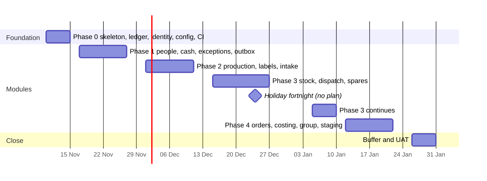

# Backend delivery plan

**Target:** a working Laravel 13 backend for every module, with the existing React prototype running against it, in **9 working weeks plus 1 buffer week** (10 November 2026 → 23 January 2027, allowing for the holiday fortnight). Two months is the plan; three is the ceiling.
**Assumptions:** one senior developer full time, AI-assisted, with the architecture in `docs/architecture/BACKEND_ARCHITECTURE.md` as the brief; the client's open questions (deduction rule, stages, standard weights) are modelled as configuration and do not block; hardware, EFRIS, mobile-money disbursement and the Android shell are out of scope. With a second developer from Phase 2, Phases 2 and 3 run in parallel and the plan shortens to about 7 weeks.

## How phases work

- Each phase delivers backend modules **and** the frontend adapter for them, so the phase ends with real screens on the real API. "Done" means the demo script for that phase runs end to end with the browser offline for part of it.
- Every task follows the module template; the definition of done is the same for all of them (below).
- One PR per task, reviewed with the architecture tests green. Branch per phase, merged to `main` at the phase gate.

### Definition of done for a command task

Migration · Eloquent model (read-only) · Command · Handler with invariants · Event class + JSON schema · Projector · Authorization policy row · Policy (if any) · Controller + FormRequest + Resource · route · Feature test (HTTP → events → projection) · Unit test for rejections · listed in OpenAPI · fixture if arithmetic · frontend adapter mapping.

---

## Phase 0 — Foundation (Week 1: 10–14 Nov)

Goal: an empty but complete skeleton that proves the ledger end to end with one command, and the repository in its final shape.

| ID | Task | Size |
|---|---|---|
| P0-01 | Repository move per ADR-010; update Netlify/Vercel paths, `tools/`, `.gitignore`; move docs | M |
| P0-02 | `apps/api`: Laravel 13 on PHP 8.5, API-only, Pint, Larastan 8, Pest 4, `pest-plugin-arch`, `brick/math`, `dedoc/scramble`, Horizon, Sanctum | S |
| P0-03 | `infra/`: Docker Compose (php 8.5-fpm, nginx, postgres 18, redis 7, horizon, scheduler, minio, mailpit), `Makefile` | M |
| P0-04 | `Shared\Ledger`: `events`, `day_locks`, `number_series`, `projection_cursors`, `reactor_runs` migrations; `Event`, `EventStore`, `Command`, `CommandBus`, `Handler`, `Projector`, `Policy`, `Reactor`, `Rejection`, `DayLocks`, `NumberSeries`, `Replay`; `ledger:rebuild` | L |
| P0-05 | `Shared\Calendar` (business day, shift id) and `Shared\Money` (`Money`, `Kg`); `Shared\Arithmetic` port of `arithmetic.ts`; `contracts/fixtures/*.json` written from the current TS tests; Pest and Vitest fixture runners | M |
| P0-06 | `Shared\Http`: problem+json responses, `Idempotency-Key`, `SiteScope`, cursor pagination | S |
| P0-07 | `Identity`: users, `user_site_roles`, devices, device sessions; `POST /auth/login`, `/auth/pin`, `DELETE /auth/session`, `GET /me`; Argon2id PINs; lockout | M |
| P0-08 | `Config`: sites, site settings, ref lists, products, prices, machines, benchmarks, zones, FX, company profile, number series; `GET /sites/{site}/config` in the prototype's shape; seeders from `apps/web/src/config/sites/*.ts` and the demo seed master data | L |
| P0-09 | `POST /events` ingestion with ordering, duplicates, rejection results, `assigned`; `GET /sites/{site}/snapshots/{projection}` delta | M |
| P0-10 | Architecture tests (module dependency rule, no writes outside projectors, no facades in handlers); replay test harness; policy-matrix dataset test | S |
| P0-11 | CI: Pint, Larastan, Pest with Postgres, OpenAPI export + `oasdiff`, `openapi-typescript` staleness check, web typecheck + Vitest | M |
| P0-12 | Frontend: `data/api/` client scaffold, auth against `/auth/*`, bootstrap from `/me` + `/config`; `VITE_DEMO` switch | M |

**Gate:** sign in as a seeded user, fetch site config, post one `config.ref_list_changed` through `/events` and see it in the snapshot delta. `make rebuild` reproduces the projection.

**Status (9 Nov 2026):** done on branch `backend/phase-0`, gate passed against the dev database. P0-01 to P0-10 and P0-12 complete; P0-11 reduced to a minimal unmaintained workflow because CI is deferred by decision (local `make check` is the gate). Additions beyond the plan: a `Sync` module owns `/events` and `/snapshots` so `Shared` stays free of module imports; config is seeded through `config.*` events so snapshot pulls from `since=0` return the seed; duplicates return the assigned number. Open item: Config tests re-seed ~400 events each, being trimmed.

## Phase 1 — People and cash (Weeks 2–3: 17–28 Nov)

| ID | Task | Size |
|---|---|---|
| P1-01 | `People`: `RegisterPerson`, `StartEngagement`, `RenewEngagement`, `EndEngagement`; projections `people`, `engagements` | M |
| P1-02 | `MarkAttendance` with `duplicate_fact` and cross-site rules; `attendance` projection; headcount query | M |
| P1-03 | `ArchivePerson`, `ReactivatePerson`; `people:archive-absent` scheduler (configurable N days) | S |
| P1-04 | Settlement: `CreateSettlementRun` (weekly casual, end-of-term, monthly) using `settlementNet` fixtures; `ApproveSettlement`, `RecordPayout`, `GiveAdvance`; `settlement_runs`, `settlement_lines`, `payouts`, `advances` | L |
| P1-05 | `Cash`: `RecordCashEntry` (opens the day), `CorrectCashEntry`, `CloseCashDay` with `cashClose` fixture and `day_locks`, `ReopenCashDay` (site manager + reason) | M |
| P1-06 | Cash projector listens to `people.payout_recorded`; `cash_days`, `cash_entries`; cash summary query (day, month by category) | S |
| P1-07 | `Group`: `exceptions` projection, `RaiseException`, `DecideException`; policies `CashVariancePolicy`, `GhostWorkerPolicy`, `ContractExpiringPolicy` + `people:contract-expiry` scheduler | M |
| P1-08 | `Media`: `POST /media` hash-addressed upload to MinIO, signed `GET /media/{hash}`; HR bucket for ID/face images | S |
| P1-09 | Seeders: import the demo seed's people, engagements, attendance and cash history as events (so projections are rebuilt, not inserted) | M |
| P1-10 | Frontend adapter: outbox (Dexie), `flushOutbox` → `/events`, rejection list UI, delta pull; People and Cash actions mapped; Today, Attendance, Sign-up, Registry, Settlement, Cash book, Expense on the API | L |

**Gate:** supervisor marks attendance offline on a phone, cashier closes the day on a desktop, reconnect, both appear in the ledger; a short close raises `cash_variance` and the CEO sees it in Approvals. Rebuild reproduces everything.

## Phase 2 — Production, labels, intake (Weeks 4–5: 1–12 Dec)

| ID | Task | Size |
|---|---|---|
| P2-01 | `RecordProductionEntry` (+ downtime), `RecordBatch`, `CloseShift`; projections; `BelowBenchmarkPolicy`, `NotLoggedPolicy` + `production:shift-unlogged` scheduler | L |
| P2-02 | Labels: `CreateLabel` (number series per kind), `ConsumeLabel`; `labels`, `label_history`; `GET /labels/{code}/history` | M |
| P2-03 | `WeighWaste`; mass balance query per day using `massBalance` fixtures; `mass_gap` policy | M |
| P2-04 | Recycling: `RecordCollectorIntake` (`intakeNet` fixtures, deduction presets from config), `PayCollector` → cash line; `collector_deliveries`; collector ledger query | M |
| P2-05 | Machine wall snapshot query (per site, shift) matching `machineWall` selector shape | S |
| P2-06 | Seeders: production, labels, intake history as events | S |
| P2-07 | Frontend adapter: Production actions mapped; Machine wall, Mixer, Extruders, Finishing, Waste, Rolls, Conversion, Film scrap, Intake, Collector ledger, Sacks, Print labels, Scan on the API | L |

**Gate:** a loom entry below benchmark without a reason raises `below_benchmark`; a label printed at finishing appears in stock; intake voucher number assigned at sync.

## Phase 3 — Stock, dispatch, spares (Weeks 6–7: 15 Dec – 9 Jan, holiday fortnight inside)

| ID | Task | Size |
|---|---|---|
| P3-01 | `Stock`: `stock_on_hand` projector from label events; `ReceiveStock`, `MoveStock`, `ScrapLabel`, `SendTransfer`/`ReceiveTransfer` | M |
| P3-02 | `RecordStockCount` → `stock.counted` + `stock.adjusted`, `day_locks` for stock; variance query | M |
| P3-03 | Purchases: `RecordPurchase`, `ReceivePurchase` with `landedCost` fixtures | S |
| P3-04 | Spares: `ReceivePart`, `IssuePart` (`LowStockPolicy`), `ReportBreakdown`, `ResolveBreakdown`; downtime cost query | M |
| P3-05 | `Dispatch`: `StartDispatch`, `ScanBundle`/`UnscanBundle` (`state_conflict` for dispatched labels), `RecordGateWeight` with `gateDecision` fixtures → pass + delivery note or hold; `GateVariancePolicy` critical; `OverrideGate` (separation of duties) | L |
| P3-06 | `ConfirmDelivery` with signature/photo media, `PodDiscrepancyPolicy`; `delivery_notes` series continuing the paper book | M |
| P3-07 | Seeders: stock, dispatch, spares history as events | S |
| P3-08 | Frontend adapter: Stock, Count, Tagging, Receive, Movements, Spares, Maintenance, Load lorry, Deliveries on the API | L |

**Gate:** a lorry loaded ten bundles short is held at the gate, the CEO is alerted (log driver), site manager overrides with a reason, the audit feed shows both.

## Phase 4 — Orders, credit, costing, group (Weeks 8–9: 12–23 Jan)

| ID | Task | Size |
|---|---|---|
| P4-01 | `Orders`: `RegisterClient`/`UpdateClient`, `SetPrice`, `CreateOrder` (local → `awaiting_cash`, export → `awaiting_approval`), `ConfirmOrderCash` → cash line, `ApproveOrder`/`HoldOrder`, `CreditLimitPolicy` | L |
| P4-02 | `IssueInvoice` (series, fiscal fields nullable), `RecordPayment`; client balance and receivables views; statement query | M |
| P4-03 | `Costing`: cost lines from cash, payouts, materials and spares events; `costing:close-period` computing unit cost per product and site P&L from closed days only | L |
| P4-04 | `Group`: cockpit query, morning brief builder + `group:morning-brief`, audit feed view over events, approvals list | M |
| P4-05 | `Messaging`: `Messenger` interface, `log` driver, `outbound_messages`; `whatsapp_cloud` driver behind a flag with template mapping | M |
| P4-06 | `Documents`: `POST /documents/{kind}/{id}/render` returning document data now; Browsershot PDF behind a flag | S |
| P4-07 | Hardening: rate limits, token expiry per role, `ledger:verify` nightly, backup script + restore drill, Sentry, `device_heartbeats` | M |
| P4-08 | Staging deployment on one VM with Compose and TLS; smoke script | M |
| P4-09 | Frontend adapter: Orders, Clients, Invoices, Purchases, Settings, Group cockpit, Approvals, Credit, Brief, Audit, People, P&L on the API; remove `buildSeed()` from production builds | L |

**Gate:** CEO approves an over-limit export order from a phone; it becomes a dispatch, a gate pass, a delivery note, an invoice, a payment; the next morning's brief (log driver) reports it; P&L for the month reads from closed days only.

## Week 10 — Buffer and UAT (26–30 Jan)

Fixes from the Phase 4 gate, a performance pass on the three heaviest queries (cockpit, machine wall, P&L), load test at ×10 event volume, and a walkthrough with the client on staging.

---

## Timeline

Working days: 45 planned + 5 buffer. If the holiday fortnight is worked, Phase 4 ends 9 January and the whole plan lands at exactly two months.

## Risks

| Risk | Effect | Mitigation |
|---|---|---|
| Client rules still open (deduction, stages, standard weights) | Rework | All modelled as config with "to be confirmed" flags; no code depends on the value |
| TS and PHP arithmetic drift | Wrong gate or settlement decisions | Fixtures first, both suites in CI (ADR-007) |
| Event payload shape changes mid-build | Frontend adapter churn | JSON schemas per event version; additive changes only after Phase 1 |
| Single developer | Schedule risk | Architecture tests and templates make each module mechanical; a second developer can take Phase 3 unaided |
| Holiday fortnight | Phase 3 split | Already scheduled around it |
| PostgreSQL 18 unavailable at the host | Deploy delay | Nothing depends on 18-only features; 17 works unchanged |
| Scope creep from the prototype's richer screens | Phase overruns | Only store actions in Appendix A are in scope; new screens wait for Phase 5 |

## What comes after (Phase 5+, not planned here)

Capacitor Android shell with BLE scale and printer plugins; WhatsApp Cloud API live; Browsershot PDFs; EFRIS when URA registration is settled; mobile-money disbursement; Reverb for live walls; PowerSync evaluation; row-level security; per-factory edge server if uplinks demand it.
